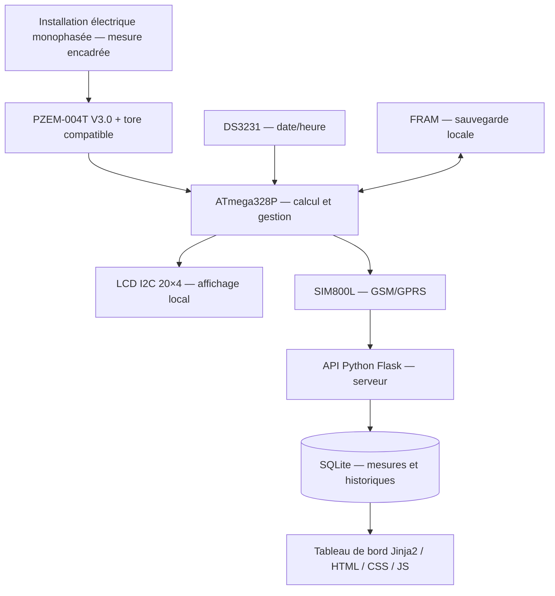

# Synoptique fonctionnel du compteur intelligent — M01

Ce diagramme représente **le trajet des informations**, pas un schéma de câblage électrique. Les circuits d'alimentation et de protection ne sont pas montrés ici.

## Parcours expliqué au débutant

1. Le **PZEM** fournit les mesures électriques.
2. L'**ATmega328P** traite les mesures et calcule la consommation.
3. Le **LCD** montre localement la date, la tension et les kWh du jour/mois.
4. Le **DS3231** fournit la date et l'heure, et la **FRAM** mémorise les données essentielles et les transmissions en attente.
5. Le **SIM800L** transmet les relevés vers Flask, si un réseau GSM/GPRS compatible est accessible.
6. **Flask** reçoit et traite les messages, **SQLite** stocke les données.
7. La page web **Jinja2/HTML/CSS/JavaScript** permet la consultation.

## Simulation pédagogique

La [maquette web fictive](demo_dashboard_fictif.html) sert uniquement à visualiser la sortie attendue, sans carte SIM, sans hébergement et sans mesure réelle.

## Distinction sécurité

**Ce fichier est un synoptique de principe, pas une notice de raccordement secteur.** Le SIM800L exige une alimentation adaptée autour de 4 V capable d'absorber ses pointes de courant, distincte du 5 V logique, et un contrôle des niveaux UART. Les essais 230 V ne sont pas destinés aux novices.
